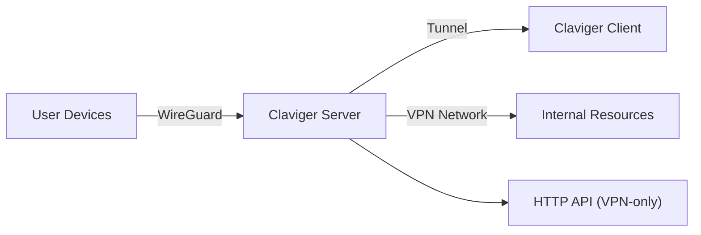
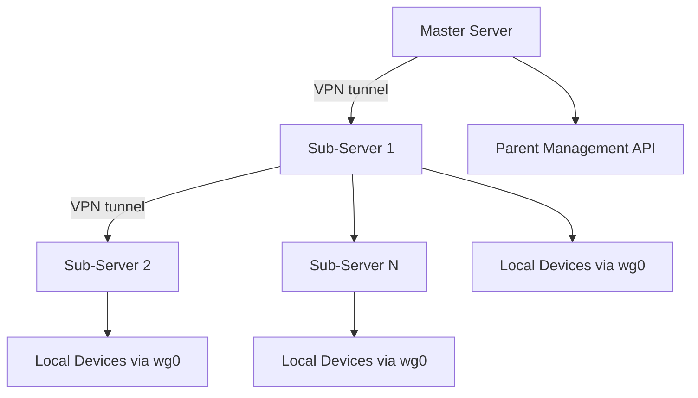

# Claviger — Zero-Trust VPN Architecture

> **Claviger** is an open-source, cross-platform Zero-Trust VPN solution built with a Go backend and a cross-platform GUI/CLI client. It uses **WireGuard** for secure network tunneling, **SQLite** for local persistence, and a modular Go architecture for extensibility.

---

## 📋 Table of Contents

1. [Overview](#overview)
2. [High-Level Architecture](#high-level-architecture)
3. [Server-Side Architecture (claviger-server)](#server-side-architecture-claviger-server)
   - [Go Backend](#go-backend)
   - [CLI Command Dispatch](#cli-command-dispatch)
   - [SQLite Persistence](#sqlite-persistence)
   - [WireGuard Transit Setup](#wireguard-transit-setup)
   - [API Package Structure](#api-package-structure)
   - [Internal Packages](#internal-packages)
   - [Build & Release](#build--release)
4. [Client-Side Architecture (claviger-client)](#client-side-architecture-claviger-client)
   - [Go Client](#go-client)
   - [IPC Architecture](#ipc-architecture)
   - [VPN Engine](#vpn-engine)
   - [Storage & Vault](#storage--vault)
   - [GUI (Fyne)](#gui-fyne)
   - [Cross-Platform Packaging](#cross-platform-packaging)
5. [Data Models & Database Schema](#data-models--database-schema)
6. [Security Model](#security-model)
7. [Deployment Architectures](#deployment-architectures)
8. [Development Guide](#development-guide)
9. [Troubleshooting](#troubleshooting)

---

## Overview

Claviger is a **Zero-Trust Network Access (ZTNA)** tool that creates secure, encrypted VPN tunnels using WireGuard. It is designed to be:

- **Self-Hosted**: Run your own VPN gateway anywhere (cloud, on-prem, Raspberry Pi).
- **Cross-Platform**: Native binaries for Linux (x86_64, ARM64), Windows (x86_64), and macOS.
- **Automated**: Zero-config setup scripts, systemd auto-start, and an auto-updater.
- **Composable**: Plugin-style internal packages for auth, crypto, firewall, and system management.
- **Multi-Tenant**: Role-based access control (admin, standard user) with granular network policies.

---

## High-Level Architecture

```mermaid
graph TD
    A["User / Admin"] --> B["Claviger Client GUI/CLI"]
    B -->|TCP IPC (localhost)| C["Claviger Daemon"]
    C --> D1["WireGuard Engine"]
    D1 -->|wg0/claviger0| E["VPN Server"]

    F["User / Device"] -->|WireGuard| tunnel["Tunnel (DNS, routes)"]
    tunnel --> E

    E --> G["HTTP API (localhost:18080)"]
    G --> H["SQLite DB"]
    G --> I["Internal Packages"]
    I --> J["Auth"]
    I --> K["Crypto"]
    I --> L["Firewall"]
    I --> M["Scheduler"]
    I --> N["Watchdog"]

    subgraph "Server Node (Linux / Mac)"
        E
        G
        H
        I
    end

    subgraph "Client Node (Windows / Linux / Mac)"
        B
        C
        D1
        F
    end
```


"""
---

## Server-Side Architecture (claviger-server)

### Go Backend

The server is a **single static binary** built with Go 1.26.0. It uses pure-Go SQLite (`modernc.org/sqlite`), and does **not** require CGO for the core VPN control plane.

**Module:** `claviger-server`

**Key Dependencies:**
| Package | Purpose |
|---|---|
| `modernc.org/sqlite` | Pure-Go SQLite driver (no CGO) |
| `golang.zx2c4.com/wireguard/wgctrl` | Programmatic WireGuard interface control |
| `github.com/golang-jwt/jwt/v5` | JWT authentication tokens |
| `github.com/pquerna/otp` | TOTP/2FA for client enrollment |
| `github.com/robfig/cron/v3` | Scheduled background tasks |
| `github.com/shirou/gopsutil/v3` | System metrics (CPU, memory, uptime) |
| `github.com/skip2/go-qrcode` | QR code generation for enrollment |
| `github.com/tyler-smith/go-bip39` | BIP39 mnemonic seed generation |
| `github.com/google/uuid` | UUID generation |
| `golang.org/x/crypto` | X25519, HKDF, PBKDF2, etc. |

### CLI Command Dispatch

The entry point is `main.go`. It dispatches commands to the `cmd/` package:

| Command | Purpose |
|---|---|
| `setup` | Initial node provisioning: keys, WireGuard base config, admin enrollment, systemd service, firewall |
| `restore <backup_file>` | Restore from an encrypted backup |
| `reset` | Wipe all configuration and client records |
| `uninstall` | Remove systemd service, firewall rules, and WireGuard config |
| `start` | Run the Edge Daemon: HTTP API + WireGuard peer sync + watchdog |
| `register` | Manually enroll a new client device into the database |
| `recovery-key` | Display the system recovery seed |
| `list [role]` | List registered clients (optionally filtered by role) |
| `public-hub <enable\|disable>` | Toggle public binding mode (0.0.0.0) for remote management |
| `revoke <client_id>` | Revoke a client's access and hot-remove from the WireGuard kernel |
| `register-node <master_ip> <sub_server_vpn_ip>` | Register this node as a child server on a master Claviger node |

### SQLite Persistence

Database location: `/var/lib/claviger/claviger.db` (Linux)

**Driver:** `modernc.org/sqlite` (pure-Go, CGO-free)

**PRAGMA settings:**
```sql
PRAGMA journal_mode=WAL;
PRAGMA busy_timeout=5000;
```

**Connection pooling:**
```go
db.SetMaxOpenConns(25)
db.SetMaxIdleConns(25)
```

**Database Schema:**

| Table | Columns | Purpose |
|---|---|---|
| `config` | `key TEXT PK`, `value TEXT` | Key/value configuration store |
| `roles` | `id`, `name`, `allow_global_internet`, `allow_intranet`, `allow_hub`, `allowed_ports`, `allowed_ips`, `created_at` | RBAC role definitions |
| `clients` | `id`, `name`, `public_key`, `ip_address`, `role_id`, `platform`, `device_id`, `status`, `last_seen`, `created_at` | Registered devices |
| `client_mfa` | `id`, `client_id`, `mfa_secret`, `totp_enabled`, `created_at` | TOTP 2FA per client |
| `invitations` | `token`, `role_id`, `expires_at`, `is_used`, `created_at` | Device enrollment invitations |
| `custom_apps` | `id`, `name`, `description`, `icon`, `compose_yaml`, `needs_dynamic_port`, `has_custom_setup`, `setup_port`, `created_at` | Plugin app definitions |
| `sub_servers` | `id`, `client_id`, `api_key`, `status`, `created_at` | Child server registrations |

**Config Keys:**
| Key | Default | Purpose |
|---|---|---|
| `config_revision` | `0` | Schema migration revision counter |
| `wg_port` | `51820` | WireGuard UDP listen port |
| `hub_port` | `18080` | Local HTTP API bind port |
| `hub_ip` | `10.8.0.1` | WireGuard interface IP |
| `node_id` | — | Node UUID (set during setup) |
| `node_secret` | — | Node authentication key |
| `master_vpn_ip` | — | Parent node VPN IP (for sub-nodes) |
| `allow_global_internet` | `false` | NAT/global routing toggle |
| `public_hub` | `false` | Public binding mode toggle |
| `ssh_lockdown_enabled` | `false` | Firewall lockdown state |


### WireGuard Transit Setup

The server uses WireGuard as the core transit mechanism. All management traffic (HTTP API, CLI, GUI) is bound to the VPN interface, ensuring that only connected devices can reach the control plane.

**Interface:** `wg0` on Linux

**Base configuration** (written by `network/wireguard.go`):
```ini
[Interface]
PrivateKey = <server_private_key>
Address = 10.8.0.1/24
ListenPort = <wg_port>
SaveConfig = false

# Peers are managed dynamically via wgctrl + SQLite
```

**Key design decisions:**
- `SaveConfig = false` — prevents the WireGuard daemon from overwriting the SQLite-driven peer state.
- **Peer management is external**: The daemon reads active clients from SQLite and injects them into the kernel via `wgctrl.ConfigureDevice()`.
- **Dead-man's switch**: The `heartbeat.go` package monitors the hub endpoint. If the hub is unreachable for 15 minutes, the WireGuard interface is stopped automatically to prevent unauthorized access.
- **IP forwarding**: Enabled at the kernel level via `sysctl net.ipv4.ip_forward=1` to allow NAT for split-tunnel clients.
- **UFW integration**: Opens the WireGuard UDP port; also manages SSH port restoration on shutdown.
- **Subnets**: Client assignments use `/32` CIDRs; the base subnet is `10.8.0.0/24`.

---

### API Package Structure

The `api/` directory contains HTTP handlers mounted in a Go `http.ServeMux`:

| File | Purpose |
|---|---|
| `auth.go` | JWT issuance, verification, and middleware |
| `middleware.go` | Hub isolation, role-based auth, rate limiting |
| `clients.go` | Client CRUD, status, and peer heartbeat sync |
| `revoke.go` | Hot-remove client from kernel (wgctrl) and DB |
| `enrollment.go` | Device enrollment, invitation validation, MFA |
| `heartbeats.go` | Dead-man's switch monitoring |
| `system.go` | System status, health checks, node info |
| `roles.go` | Role management and policy queries |
| `gateway.go` | Gateway/API routing for sub-services |
| `network.go` | Network diagnostics and peer management |
| `status.go` | Daemon status and readiness endpoints |
| `apps.go` | Custom app catalog sync and lifecycle |
| `containers.go` | Docker container management for apps |
| `customapps.go` | User-defined custom apps |
| `notifications.go` | Push/console notifications |
| `llm.go` | LLM configuration and catalog |
| `fail2ban.go` | Fail2ban-style abuse detection |
| `mfa_enabled.go`, `mfa_remove.go` | 2FA management |
| `logs.go` | Log aggregation and retrieval |
| `catalog_sync.go` | Centralized catalog synchronization |
| `access.go` | Access policy evaluation |
| `fleet.go` | Fleet management |
| `node.go` | Node management for multi-node deployments |
| `settings.go` | Hub configuration settings |

---

### Internal Packages

The `internal/` directory contains self-contained Go packages. Each is a focused domain module:

| Package | Files | Responsibility |
|---|---|---|
| `auth` | `token.go`, `enrollment.go` | Token encoding/decoding, admin enrollment, standard user enrollment, connection approval, connection request decoding |
| `crypto` | `aes.go`, `seed.go` | AES-256 encryption, BIP39 mnemonic generation, backup key derivation |
| `firewall` | `enforcer.go`, `nat.go`, `rules.go` | UFW/ACL enforcement, NAT rule management, CIDR allow/deny lists |
| `system` | `backup.go`, `init.go`, `service.go`, `state.go`, `updater.go` | Backup/restore, environment init, systemd service management, node state, auto-updater |
| `scheduler` | `scheduler.go` | Cron-like background task scheduler |
| `watchdog` | `config.go`, `engine.go`, `sensors.go` | Daemon watchdog, system metrics, health monitoring |
| `types` | `models.go` | Shared types and API request/response models |
| `access` | — | Access policy evaluation engine |
| `apps` | — | App packaging, installation, lifecycle |
| `docker` | — | Docker client integration for containers |
| `gateway` | — | HTTP API gateway routing |
| `hardware` | — | Hardware fingerprinting and detection |
| `notifier` | — | Event notification dispatch |
| `security` | — | Security policy and policy evaluation |


"""


### Build & Release

`build.sh` produces statically-linked binaries:

| Target | GOOS | GOARCH | CGO |
|---|---|---|---|
| Linux AMD64 | `linux` | `amd64` | `0` (static) |
| Linux ARM64 | `linux` | `arm64` | `0` (static) |

**Output:** `release/` folder with:
- `claviger-server-amd64`
- `claviger-server-arm64`
- `checksums-server.txt` (SHA256 of all binaries)

---

## Client-Side Architecture (claviger-client)

### Go Client

The client is also a **single static binary** (with GUI on Windows/Linux). It is built with Go 1.26.0 and uses the **Fyne UI toolkit** for the desktop GUI.

**Module:** `claviger-client`

**Key Dependencies:**
| Package | Purpose |
|---|---|
| `fyne.io/fyne/v2` | Cross-platform GUI toolkit (Windows/Linux GUI) |
| `golang.zx2c4.com/wireguard` | WireGuard device management |
| `golang.zx2c4.com/wireguard/wgctrl` | Programmatic WireGuard control |
| `golang.zx2c4.com/wireguard/tun` | TUN device creation |
| `golang.zx2c4.com/wireguard/wintun` | Windows TUN/TAP adapter (Windows only) |
| `github.com/google/uuid` | Device UUID generation |
| `golang.org/x/crypto` | Crypto primitives |

### IPC Architecture

The client uses a **multi-process architecture** to separate the GUI from the privileged VPN daemon:

| Binary | Port | Role |
|---|---|---|
| `claviger-windows-gui.exe` / Linux GUI | `127.0.0.1:42900` | Fyne GUI application |
| `claviger-windows-cli.exe` | — | CLI commands (non-GUI) |
| `claviger` (daemon) | `127.0.0.1:42899` | Background daemon (Linux/Windows service) |

**Key design decisions:**
- GUI and daemon each bind their own local TCP ports, guaranteeing **single-instance enforcement**.
- The GUI dials the daemon port on startup; if the daemon is already running, the existing instance wakes up and the new process exits.
- The daemon owns the **WireGuard engine**, the **VPN tunnel**, and the **OS routing table**.
- The GUI and CLI communicate with the daemon via a **custom TCP command protocol** over localhost.

### IPC Command Protocol

All commands are sent as text over TCP, delimited by `|`:

```
CONNECT|<profile_id>|<route_mode>
SET_AUTOCONNECT|<true|false>
SET_GLOBAL_ROUTING|<true|false>
REMOVE|<profile_id>
WAKEUP
SUBSCRIBE
```

**Sample request/response:**
```text
Client --> Daemon: CONNECT|default-profile|global
Daemon <-- Client: OK

Client --> Daemon: REMOVE|default-profile
Daemon <-- Client: OK
```


"""


### VPN Engine

`internal/vpn/engine.go` implements the `vpn.Engine` type, which wraps the WireGuard device:

**Tunnel States:**
| State | Description |
|---|---|
| `Disconnected` | Tunnel is off |
| `Connecting` | Tunnel is being established |
| `Verifying` | Waiting for first WireGuard handshake |
| `Secured` | Tunnel is active and traffic is flowing |
| `Reconnecting` | Lost connectivity; attempting to reconnect |

**Engine lifecycle:**
1. Resolve server endpoint (convert hostname to raw IP for WireGuard UAPI).
2. Create TUN device (`claviger0` on Windows/Linux, `utun` on macOS).
3. Create `device.Device` with the profile's keys.
4. Inject WireGuard config via `IpcSet()` (memory-only, not on-disk).
5. Bring interface UP.
6. Inject OS routes (split tunnel or global routing).
7. Start watchdog (180-second heartbeat monitor).
8. Start sync manager for state sync with the hub.

**Disconnect:**
1. Cancel sync context.
2. Cancel watchdog.
3. Clean up OS routes and DNS.
4. Close WireGuard device.
5. Set state to `Disconnected`.

### Storage & Vault

`internal/config/vault.go` implements the **ClientVault** — the client's local state store.

**Storage location:**
| OS | Path |
|---|---|
| Windows | `C:\ProgramData\Claviger\vault.json` |
| Linux | `/var/lib/claviger-client/vault.json` |
| macOS | `/Library/Application Support/Claviger/vault.json` |

**Vault structure:**
```json
{
  "device_id": "uuid-v4",
  "use_global_routing": false,
  "auto_connect": false,
  "active_profile_id": "default-profile",
  "profiles": {
    "default-profile": {
      "id": "default-profile",
      "name": "Cloudrocean Hub",
      "private_key": "...",
      "public_key": "...",
      "assigned_ip": "10.8.0.2",
      "server_public_key": "...",
      "server_endpoint": "46.225.66.35:51820",
      "dns": "1.1.1.1",
      "base_subnet": "10.8.0.0/24",
      "config_revision": "1",
      "hub_port": "18080"
    }
  }
}
```

**Permissions:** `0644` (readable by standard users, writable by root). Legacy fields are auto-migrated at load time.

### GUI (Fyne)

The GUI is implemented in `internal/gui/` using **Fyne**. Key files:

| File | Purpose |
|---|---|
| `gui.go` | Application entry point, window setup |
| `dashboard.go` | Main dashboard with profile list and control panel |
| `enrollment.go` | Client enrollment and QR code display |
| `events.go` | Event handling, notifications |
| `bundled.go` | Embedded icon resource |

The GUI subscribes to the daemon's event stream via the IPC protocol and updates the UI reactively.

### Cross-Platform Packaging

**Windows (Inno Setup):**
- `claviger-windows-gui.iss` is the installer script.
- Runs with **admin privileges**.
- Registers `claviger.exe` as a **Windows service** (`ClavigerService`) so the VPN runs automatically on boot.
- Adds the app directory to the **system PATH**.
- Creates **start-on-login** registry entry.
- Safe upgrade logic: stops the service before file replacement to avoid `Access Denied`.

**Linux (nFPM):**
- `packaging/nfpm-amd64.yaml` and `packaging/nfpm-arm64.yaml` define package metadata.
- Builds `.deb` and `.rpm` packages.
- Files are installed to `/opt/claviger/` or similar system paths.
- Systemd service unit is installed.


"""


## Data Models & Database Schema

### Server Database (SQLite)

#### Roles
| Column | Type | Purpose |
|---|---|---|
| `id` | TEXT PK | Role UUID |
| `name` | TEXT | e.g., "Administrator", "Standard User" |
| `allow_global_internet` | BOOLEAN | Allow global internet routing |
| `allow_intranet` | BOOLEAN | Allow intranet access |
| `allow_hub` | BOOLEAN | Allow hub (GUI/API) access |
| `allowed_ports` | TEXT | Comma-separated port list (default: "ALL") |
| `allowed_ips` | TEXT | CIDR allow/deny list (default: "ALL") |

#### Clients
| Column | Type | Purpose |
|---|---|---|
| `id` | TEXT PK | Client UUID |
| `name` | TEXT | Human-readable name |
| `public_key` | TEXT | WireGuard public key |
| `ip_address` | TEXT | Assigned VPN IP (/32) |
| `role_id` | TEXT FK | RBAC role |
| `platform` | TEXT | OS/platform of the device |
| `device_id` | TEXT | Hardware identifier |
| `status` | TEXT | `pending`, `active`, `revoked`, `suspended` |
| `last_seen` | DATETIME | Last handshake timestamp |
| `created_at` | DATETIME | Registration time |

---

## Security Model

Claviger's security model is built on **Zero-Trust** principles:

1. **No public exposure**: The HTTP API is bound to the VPN interface (`10.8.0.1:18080`) by default, not to the public internet.
2. **WireGuard encryption**: All transit traffic uses WireGuard (AES-256-GCM, X25519 key exchange, ChaCha20-Poly1305 for UDP encapsulation).
3. **JWT authentication**: API endpoints require a JWT token issued during enrollment; tokens are scoped to roles and policies.
4. **Role-based access control (RBAC)**: Clients are assigned roles (`admin`, `standard`) with granular network policies (allowed ports, IPs, hub access).
5. **Device verification**: Devices are identified by a persistent `device_id`; enrollment requires a server-issued token.
6. **Dead-man's switch**: If the hub is unreachable for 15 minutes, the WireGuard interface is **automatically stopped** to prevent unauthorized access.
7. **Auto-updater**: Signed binaries with SHA256 checksums prevent tampered updates from being applied.
8. **AES-256 encryption**: Sensitive data (config, backups) is encrypted at rest using AES-256 via the `crypto` package.
9. **TOTP 2FA**: Clients can enable TOTP two-factor authentication for additional enrollment security.
10. **Firewall enforcement**: UFW rules are managed programmatically to enforce least-privilege network access.


"""


### Deployment Architectures

#### Single-Node Deployment



- Standard setup: 1 server, 1 admin, multiple standard clients.
- All traffic routed over `wg0`.
- SQLite at `/var/lib/claviger/claviger.db`.

#### Multi-Node (Sub-Server) Deployment



- Master server runs `public-hub` mode (`0.0.0.0:18080`).
- Sub-servers use `register-node` to register with the master.
- Sub-servers maintain their own WireGuard `wg0` interface.
- The master acts as a hub for commands, while sub-servers handle local device routing.
- Each node has its own SQLite database and local state.

---

## Development Guide

### Prerequisites

- Go 1.26.0+
- Git
- (Linux) `sudo` access for WireGuard, UFW, systemd installation
- (Windows) MinGW cross-compiler for CLI toolchain, Inno Setup for packaging

### Running the Server

```bash
cd claviger-server

# 1. Initialize the node
sudo ./claviger-server setup

# 2. Start the daemon
sudo ./claviger-server start

# Check status
./claviger-server list

# Revoke a client
./claviger-server revoke <client_id>
```

### Running the Client

**Windows:**
```powershell
# Install as a service and start GUI
.\claviger-windows-gui.exe
```

**Linux:**
```bash
# Build and install
sudo ./build.sh
sudo dpkg -i release/claviger_client_amd64.deb

# Start daemon (for testing)
sudo claviger-client daemon

# Start GUI
fyne run
```

### Modifying Internal Packages

Each `internal/` package is independently testable. For example, to modify the firewall enforcer:

```bash
cd claviger-server/internal/firewall
go test -v ./...
```


"""


## Troubleshooting

| Symptom | Likely Cause | Resolution |
|---|---|---|
| `❌ Node is not configured` | Tried to run `start` before `setup` | Run `claviger-server setup` first |
| WireGuard interface `wg0` not up | `wg-quick up wg0` failed | Check UFW, iptables, and `sysctl net.ipv4.ip_forward` |
| API unreachable via `http://<server_ip>:18080` | Hub binding mode is not `public_hub` | Run `claviger-server public-hub enable` for remote management |
| Client handshake fails repeatedly | Server endpoint resolution issue | Ensure DNS is correct; verify WireGuard endpoint is a raw IP |
| Daemon already running | Port `42899` is locked | Kill existing daemon or re-run GUI (it auto-wakes existing instance) |
| `wg_quick` not found | WireGuard tools not installed | Server's `network.InstallWireGuard()` handles this, or install manually: `apt install wireguard wireguard-tools` |
| Client shows "Verifying" forever | No handshake within 180s | Check firewall rules, server WireGuard status, and network connectivity |

---

## License

*(Add your license here — e.g., MIT, GPL-3.0, etc.)*

---

## Support

- **Project Repository**: [https://github.com/<your-org>/claviger](https://github.com/<your-org>/claviger)
- **Documentation**: `docs/` in the repo
- **Issues**: GitHub Issues tracker
- **Community**: *your preferred community channel*


